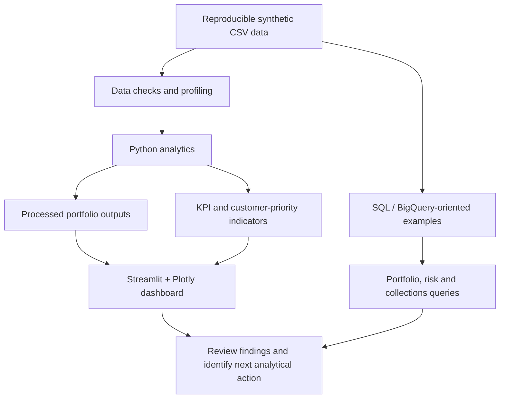

<div align="center">


# CreditLens 360 — BFSI Analytics

### **FinCore AI** · Lending Portfolio Intelligence · Credit Risk · Collections · Customer Analytics

<p>
  <a href="https://github.com/VidhyaBoda/CreditLens-360-BFSI-Analytics/actions/workflows/ci.yml"></a>
  
  
  
  
  
  <a href="LICENSE"></a>
</p>

**Turn lending data into portfolio visibility, risk signals, collection priorities, and customer opportunities.**

<p>
  <a href="#-quick-start">Quick Start</a> ·
  <a href="#-what-you-can-explore">Features</a> ·
  <a href="#-technology-stack">Technology</a> ·
  <a href="#-solution-architecture">Architecture</a> ·
  <a href="#-kpi-framework">KPIs</a> ·
  <a href="#-testing-and-ci">Testing</a>
</p>

<p>
  <a href="https://www.linkedin.com/in/vidhya-boda51/"></a>
  <a href="https://github.com/VidhyaBoda/CreditLens-360-BFSI-Analytics"></a>
  <a href="mailto:vidhyabboda@gmail.com"></a>
</p>

</div>

---

## 🧭 Project overview

**CreditLens 360** is a portfolio-ready BFSI analytics project presented under the product identity **FinCore AI**. It simulates an analytical workflow for a retail bank or NBFC by connecting synthetic customer, loan, repayment, transaction, and insurance data with Python analysis, SQL examples, dashboard assets, and a Streamlit application.

The goal is to demonstrate how an analyst can move from a business question to validated data, measurable KPIs, interpretable visuals, and a clearly explained next action.

> [!IMPORTANT]
> **Synthetic-data portfolio project.** All generated records are illustrative. The metrics are not audited financial results, production underwriting decisions, real customer records, or regulatory NPA/NPL classifications.

## 📌 Project at a glance

<table>
  <tr>
    <td align="center" width="25%"><h3>5,000</h3><sub>Synthetic customers</sub></td>
    <td align="center" width="25%"><h3>7,200</h3><sub>Synthetic loans</sub></td>
    <td align="center" width="25%"><h3>30,000</h3><sub>Transactions</sub></td>
    <td align="center" width="25%"><h3>5</h3><sub>Data domains</sub></td>
  </tr>
</table>

| Dimension | Summary |
|---|---|
| **Business domain** | Retail lending, banking, financial services, and insurance (BFSI) |
| **Analytical focus** | Portfolio monitoring, credit-risk indicators, collections, customer intelligence, insurance cross-sell |
| **Core workflow** | Synthetic data generation → validation → analysis → KPI calculation → visualisation |
| **Primary application** | Streamlit and Plotly dashboard |
| **Query layer** | SQL scripts designed as BigQuery-oriented examples |
| **Quality checks** | Pytest plus a GitHub Actions workflow |

## ✨ What you can explore

| Analytical area | Business questions | Example outputs |
|---|---|---|
| **Portfolio management** | How large is the lending portfolio? Which products contribute most? | Outstanding principal, original loan value, product mix |
| **Credit risk** | Where is delinquency concentrated? How many loans have 90+ DPD? | DPD buckets, delinquency indicators, 90+ DPD analytical proxy |
| **Collections** | What is the due-versus-paid gap? Which records may need attention? | Amount due, amount paid, collection gap, heuristic priority score |
| **Customer intelligence** | How are customers distributed by profile and geography? | Income, credit score, segment, and location views |
| **Transactions** | What activity signals appear in the simulated data? | Transaction types, amounts, and activity summaries |
| **Insurance cross-sell** | How much simulated policy coverage exists? | Active-policy rate and potential coverage whitespace |
| **Management reporting** | How can analysis be communicated to decision-makers? | KPI summaries, dashboard visuals, SQL outputs |

## 🛠️ Technology stack

The badges below link the project’s tooling to their official websites. They are visual identifiers; a badge by itself does not imply a cloud deployment or a live third-party integration.

| Layer | Technologies | Badge |
|---|---|---|
| Data analysis | Python, Pandas, NumPy | <a href="https://www.python.org/"></a> |
| Querying | SQL, BigQuery-oriented SQL | <a href="https://cloud.google.com/bigquery"></a> |
| Interactive application | Streamlit, Plotly | <a href="https://streamlit.io/"></a> <a href="https://plotly.com/"></a> |
| Business intelligence | Power BI | <a href="https://powerbi.microsoft.com/"></a> |
| Visual analytics | Tableau | <a href="https://www.tableau.com/"></a> |
| Statistical scripts | R, SAS |   |
| Spreadsheet workflow | Microsoft Excel |  |
| Testing and automation | Pytest, GitHub Actions |   |
| Version control | Git, GitHub | <a href="https://github.com/VidhyaBoda/CreditLens-360-BFSI-Analytics"></a> |
| Optional AI exploration | OpenAI tooling may be considered as a future extension; core setup does not require an OpenAI API key |  |

## 🧩 Solution architecture



**Analytical workflow:** `Generate → Validate → Analyse → Calculate KPIs → Visualise → Interpret → Act`

## 🚀 Quick Start

### 1. Clone the repository

```bash
git clone https://github.com/VidhyaBoda/CreditLens-360-BFSI-Analytics.git
cd CreditLens-360-BFSI-Analytics
```

### 2. Create and activate a virtual environment

**Windows PowerShell**

```powershell
python -m venv .venv
.\.venv\Scripts\Activate.ps1
```

**macOS / Linux**

```bash
python3 -m venv .venv
source .venv/bin/activate
```

### 3. Install dependencies

```bash
python -m pip install --upgrade pip
python -m pip install -r requirements.txt
python -m pip install pytest
```

### 4. Generate the synthetic datasets

```bash
python python/generate_data.py
```

The generator creates five CSV files inside `data/raw/`. Raw CSV files are intentionally excluded from Git to keep generated data out of the repository. Run this step after cloning and before the analysis pipeline or tests.

### 5. Run the analytics pipeline

```bash
python python/analysis.py
```

The analysis script reads generated inputs and writes derived outputs to `data/processed/` as configured by the project.

### 6. Launch the dashboard

```bash
python -m streamlit run app/app.py
```

Open the local URL printed by Streamlit in your browser.

### 7. Run tests and syntax checks

```bash
python -m pytest -q
python -m compileall -q app python tests
```

## 📊 Dashboard and BI assets

The repository contains dashboard reference images for portfolio presentation and documentation. They are static assets; their presence does **not** mean a live Power BI Service or Tableau deployment is included.

<table>
  <tr>
    <td align="center" width="50%">
      <strong>Power BI dashboard reference</strong><br/><br/>
      <br/>
      <sub><a href="powerbi/README.md">Power BI documentation</a></sub>
    </td>
    <td align="center" width="50%">
      <strong>Tableau dashboard reference</strong><br/><br/>
      <br/>
      <sub><a href="tableau/README.md">Tableau documentation</a></sub>
    </td>
  </tr>
</table>

## 🗃️ Synthetic data model

The data generator uses a fixed random seed, making the dataset reproducible for a consistent generator and dependency version.

| File | Approximate records | Purpose |
|---|---:|---|
| `customers.csv` | 5,000 | Customer ID, age, income, segment, credit score, geography, join date |
| `loans.csv` | 7,200 | Customer link, product, channel, disbursement date, principal, tenure, interest rate, DPD, status, outstanding principal |
| `repayments.csv` | 7,200 | One illustrative due/paid observation per loan |
| `transactions.csv` | 30,000 | Synthetic transaction ID, customer link, date, type, amount |
| `insurance_policies.csv` | 5,000 | Policy type, annual premium, customer link, active-policy flag |

### Data relationships

- `customers.customer_id` links to `loans.customer_id`, `transactions.customer_id`, and `insurance_policies.customer_id`.
- `loans.loan_id` links to `repayments.loan_id`.
- `repayments.csv` represents **one observation per loan**, not a full monthly repayment-event history.
- Every generated record is synthetic; do not treat it as real consumer or bank data.

## 📐 KPI framework

| KPI / indicator | Illustrative calculation | Business interpretation |
|---|---|---|
| **Outstanding portfolio / AUM proxy** | Sum of `outstanding_principal` | Outstanding exposure represented in the synthetic portfolio |
| **Original loan value** | Sum of `original_amount` | Original principal represented by the loan records |
| **Delinquency indicator** | Loans with `dpd > 0` ÷ selected loan population | Share of loans with positive days past due |
| **90+ DPD indicator** | Loans with `dpd >= 90` ÷ selected loan population | Severe-delinquency proxy for analytical review |
| **Collection gap** | `amount_due - amount_paid` | Difference between illustrative due and paid amounts |
| **Collection efficiency** | Computed from per-row paid/due ratios in the analysis script | Indicative recovery measure; verify aggregation assumptions before comparison |
| **Insurance coverage / penetration** | Active-policy records relative to the chosen customer population | Coverage indicator within the synthetic scenario |
| **Customer-priority score** | Heuristic using normalised AUM, capped maximum DPD, and average rate | Triage-style ranking—not probability of default |

> **Metric discipline:** Population filters, aggregation rules, observation dates, and denominator selection affect KPI values. See [`docs/KPI_DEFINITIONS.md`](docs/KPI_DEFINITIONS.md) before interpreting or comparing results. A 90+ DPD indicator is **not** a regulatory NPA/NPL determination.

## 🧠 SQL / BigQuery query layer

The numbered scripts follow an analytical workflow from data preparation through portfolio, risk, collections, and insurance queries.

| Script | Purpose |
|---|---|
| [`01_staging.sql`](sql/bigquery/01_staging.sql) | Staging and data preparation |
| [`02_mart_portfolio.sql`](sql/bigquery/02_mart_portfolio.sql) | Portfolio analytics mart |
| [`03_kpi_queries.sql`](sql/bigquery/03_kpi_queries.sql) | KPI queries |
| [`04_credit_risk.sql`](sql/bigquery/04_credit_risk.sql) | Credit-risk analysis |
| [`05_collections.sql`](sql/bigquery/05_collections.sql) | Collections analysis |
| [`06_customer_insurance.sql`](sql/bigquery/06_customer_insurance.sql) | Customer and insurance analysis |

These SQL files are examples to review and adapt. Running them in BigQuery requires a configured Google Cloud project, suitable datasets and permissions, and matching table references.

## 🧪 Testing and CI

The project includes a pytest suite and a GitHub Actions workflow. The CI workflow is configured to:

1. Check out the repository and set up Python.
2. Install project dependencies and pytest.
3. Generate synthetic input datasets.
4. Run automated tests.
5. Compile Python source files.

[](https://github.com/VidhyaBoda/CreditLens-360-BFSI-Analytics/actions/workflows/ci.yml)

A passing workflow confirms only the checks encoded in CI. It is not proof of production readiness, model validity, regulatory compliance, or financial accuracy.

## 📁 Project structure

```text
CreditLens-360-BFSI-Analytics/
├── .github/
│   └── workflows/
│       ├── ci.yml
│       ├── generator-generic-ossf-slsa3-publish.yml
│       ├── python-publish.yml
│       └── r.yml
├── app/
│   └── app.py
├── assets/
│   └── FinCore Header.png
├── data/
│   ├── raw/                         # Generated locally; CSVs ignored by Git
│   ├── processed/
│   │   ├── customer_priority.csv
│   │   └── portfolio_by_state_product.csv
│   └── README.md
├── docs/
│   ├── ARCHITECTURE.md
│   ├── DATA_DICTIONARY.md
│   ├── INTERVIEW_STORY.md
│   ├── KPI_DEFINITIONS.md
│   └── SETUP.md
├── excel/
│   └── FinSight_BFSI_Analytics_Excel.xlsx
├── powerbi/
│   ├── Images/
│   └── README.md
├── python/
│   ├── analysis.py
│   ├── generate_data.py
│   └── utils.py
├── r/
│   └── eda.R
├── sas/
│   └── risk_analysis.sas
├── sql/
│   └── bigquery/
│       ├── 01_staging.sql
│       ├── 02_mart_portfolio.sql
│       ├── 03_kpi_queries.sql
│       ├── 04_credit_risk.sql
│       ├── 05_collections.sql
│       └── 06_customer_insurance.sql
├── tableau/
│   ├── Images/
│   └── README.md
├── tests/
│   └── test_project.py
├── .gitignore
├── LICENSE
├── pyproject.toml
├── README.md
└── requirements.txt
```

## 📚 Project documentation

| Document | Purpose |
|---|---|
| [`docs/ARCHITECTURE.md`](docs/ARCHITECTURE.md) | Solution design and component flow |
| [`docs/DATA_DICTIONARY.md`](docs/DATA_DICTIONARY.md) | Dataset fields and descriptions |
| [`docs/KPI_DEFINITIONS.md`](docs/KPI_DEFINITIONS.md) | KPI definitions and interpretation notes |
| [`docs/SETUP.md`](docs/SETUP.md) | Environment and setup guidance |
| [`docs/INTERVIEW_STORY.md`](docs/INTERVIEW_STORY.md) | Project explanation and interview talking points |
| [`data/README.md`](data/README.md) | Data folder notes |
| [`powerbi/README.md`](powerbi/README.md) | Power BI asset notes |
| [`tableau/README.md`](tableau/README.md) | Tableau asset notes |

## 🎯 Recruiter-friendly project highlights

- **End-to-end workflow:** synthetic data generation, analysis, KPI reporting, dashboard assets, and testing.
- **Business-first thinking:** maps lending and collections questions to measurable indicators.
- **Technical breadth:** Python, SQL, BigQuery-oriented scripts, Streamlit, Plotly, R, SAS, Excel, and BI documentation.
- **Reproducibility:** the generator uses a fixed random seed, and CI regenerates the raw datasets before tests.
- **Responsible interpretation:** documents synthetic-data constraints and avoids labelling heuristic scores as validated credit-risk predictions.

### Interview-ready summary

> **CreditLens 360 / FinCore AI** is an end-to-end BFSI analytics portfolio project that simulates retail-lending data across customers, loans, repayments, transactions, and insurance. I use Python for data generation and analysis, SQL for portfolio and risk queries, and a Streamlit dashboard for KPI exploration. The project demonstrates how to turn data into portfolio visibility, delinquency indicators, collection-gap analysis, and customer-insurance opportunities, while documenting synthetic-data and regulatory limitations.

## ⚠️ Scope and limitations

- **Synthetic portfolio:** output does not represent real customers, actual bank performance, or real credit exposure.
- **Not a production scoring model:** customer priority is a heuristic for analytical triage, not a validated probability-of-default score or lending recommendation.
- **Simplified repayments:** one generated repayment observation per loan does not model a complete payment history.
- **Regulatory caution:** 90+ DPD is an analytical indicator only and must not be presented as a regulatory NPA/NPL result.
- **Tool boundaries:** Python, SQL, R, SAS, Excel, Power BI, and Tableau assets may need separate runtimes or configuration; the Python quick-start does not execute every tool.
- **Static demo:** no live bank feed, production scheduler, or operational decision service is implied.

## 🗺️ Future improvements

- Expand repayment data into a dated monthly event history.
- Add schema, referential-integrity, and boundary-condition tests.
- Reconcile Python outputs against SQL KPI results.
- Introduce a semantic layer for consistent metric definitions.
- Add predictive modelling only with suitable labels, temporal validation, calibration, and explainability.
- Package the dashboard with deployment configuration, monitoring, and access controls.

## 👩‍💻 Author

<div align="center">

### **Vidhya Boda**

**Data Analyst · Business Intelligence Analyst · Business Analyst**

<p>
  <a href="https://www.linkedin.com/in/vidhya-boda51/"></a>
  <a href="https://github.com/VidhyaBoda"></a>
  <a href="mailto:vidhyabboda@gmail.com"></a>
</p>

</div>

## 📄 License

This project is distributed under the [MIT License](LICENSE).

---

<div align="center">

### ⭐ From business question to measurable insight

**Business problem → Data → Validation → Analysis → KPI → Visualisation → Insight → Action**

*Built as a learning and portfolio project by Vidhya Boda.*

</div>
