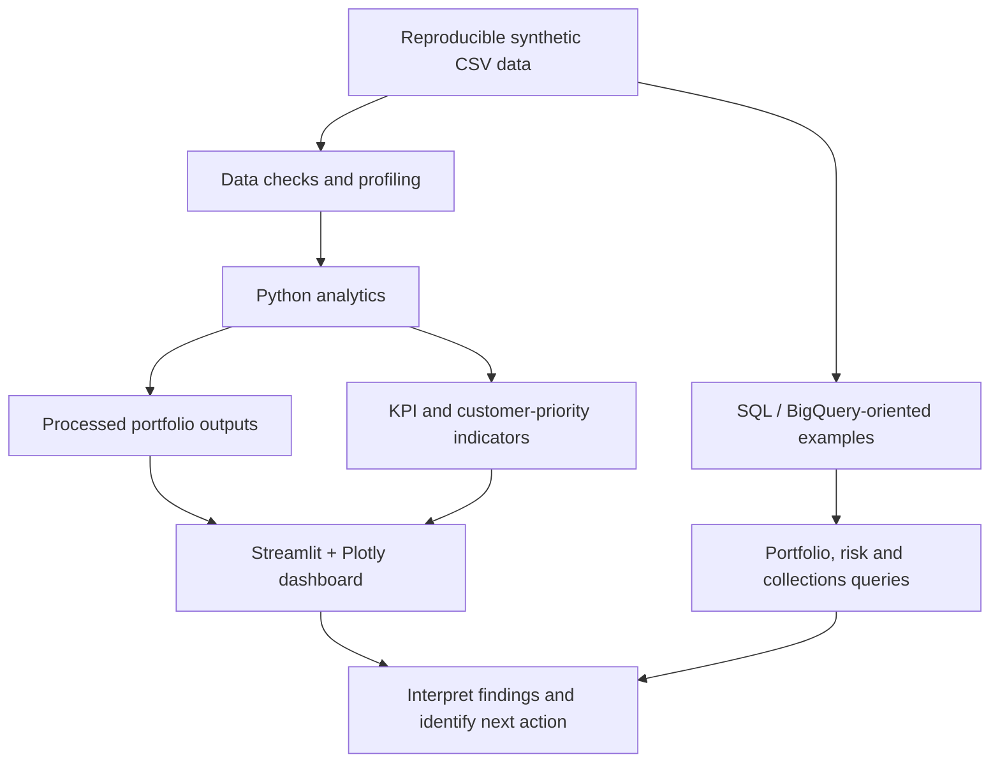

<div align="center">


# CreditLens 360 | BFSI Analytics

### **FinCore AI** · Lending Portfolio Intelligence · Credit Risk · Collections · Customer Analytics

<p>
  <a href="https://github.com/VidhyaBoda/CreditLens-360-BFSI-Analytics/actions/workflows/ci.yml"></a>
  
  
  
  
  
  <a href="LICENSE"></a>
</p>

**Turn lending data into portfolio visibility, risk signals, collection priorities, and customer opportunities.**

<p>
  <a href="#-quick-start">Quick Start</a> ·
  <a href="#-business-value">Business Value</a> ·
  <a href="#-technology-stack">Technology</a> ·
  <a href="#-solution-architecture">Architecture</a> ·
  <a href="#-kpi-framework">KPIs</a> ·
  <a href="#-dashboard-preview">Dashboard</a> ·
  <a href="#-testing-and-ci">Testing</a>
</p>

<p>
  <a href="https://www.linkedin.com/in/vidhya-boda51/"></a>
  <a href="https://github.com/VidhyaBoda"></a>
  <a href="mailto:vidhyabboda@gmail.com"></a>
</p>

</div>

---

## 🧭 Project overview

**CreditLens 360** is an end-to-end BFSI analytics portfolio project presented under the product identity **FinCore AI**. It simulates a retail-lending analytics workflow by connecting synthetic customer, loan, repayment, transaction, and insurance data with Python analysis, SQL examples, a Streamlit dashboard, and BI reference assets.

The project demonstrates an analyst's workflow from business questions to data preparation, metrics, visualisation, interpretation, and practical next steps.

> [!IMPORTANT]
> **Synthetic-data portfolio project.** All generated records are illustrative. Results are not actual bank performance, real customer data, production underwriting decisions, validated default probabilities, or regulatory NPA/NPL classifications.

## ✨ Business value

| Business area | Questions explored | Example outputs |
|---|---|---|
| **Portfolio management** | How large is the simulated lending book? Which products contribute most? | Outstanding principal, original loan value, product mix |
| **Credit risk** | Where is delinquency concentrated? How many loans have 90+ DPD? | DPD buckets, delinquency rate, 90+ DPD analytical indicator |
| **Collections** | What is the difference between amounts due and paid? Which records need review? | Collection gap, collection efficiency, heuristic priority queue |
| **Customer intelligence** | How do customer profiles and geography vary? | Income, credit score, segment, geography |
| **Transactions** | What activity signals occur in the simulated data? | Transaction types, amounts, activity summaries |
| **Insurance** | Where may coverage whitespace exist? | Active-policy indicators and potential cross-sell opportunities |
| **Management reporting** | How can an analyst communicate findings? | KPI summaries, dashboard visuals, query outputs |

## 📌 Project at a glance

<table>
  <tr>
    <td align="center" width="25%"><h3>5,000</h3><sub>Synthetic customers</sub></td>
    <td align="center" width="25%"><h3>7,200</h3><sub>Synthetic loans</sub></td>
    <td align="center" width="25%"><h3>30,000</h3><sub>Synthetic transactions</sub></td>
    <td align="center" width="25%"><h3>5</h3><sub>Data domains</sub></td>
  </tr>
</table>

| Dimension | Details |
|---|---|
| **Domain** | Banking, financial services, retail lending, insurance |
| **Core stack** | Python, Pandas, NumPy, SQL, Streamlit, Plotly |
| **Additional assets** | BigQuery-oriented SQL, R, SAS, Excel, Power BI and Tableau reference materials |
| **Reproducibility** | Fixed random seed in the synthetic data generator |
| **Quality checks** | Pytest suite and GitHub Actions workflow |
| **Primary entry points** | `python/generate_data.py`, `python/analysis.py`, `app/app.py` |

## 🛠️ Technology stack

The badges below identify the technologies associated with the repository. They do not, by themselves, imply that a third-party cloud service is deployed or that every tool runs through the Python quick-start.

| Layer | Technology | Badge |
|---|---|---|
| Data generation and analysis | Python, Pandas, NumPy | <a href="https://www.python.org/"></a> |
| Querying | SQL, BigQuery-oriented SQL | <a href="https://cloud.google.com/bigquery"></a> |
| Interactive application | Streamlit, Plotly | <a href="https://streamlit.io/"></a> <a href="https://plotly.com/"></a> |
| Business intelligence | Power BI | <a href="https://powerbi.microsoft.com/"></a> |
| Visual analytics | Tableau | <a href="https://www.tableau.com/"></a> |
| Statistical scripts | R, SAS |   |
| Spreadsheet workflow | Excel |  |
| Testing | Pytest |  |
| CI automation | GitHub Actions | <a href="https://github.com/VidhyaBoda/CreditLens-360-BFSI-Analytics/actions"></a> |
| Version control | Git, GitHub | <a href="https://github.com/VidhyaBoda/CreditLens-360-BFSI-Analytics"></a> |

## 🧩 Solution architecture



**Analytical workflow:** `Generate → Validate → Analyse → Calculate KPIs → Visualise → Interpret → Act`

## 🚀 Quick Start

### 1. Clone the repository

```bash
git clone https://github.com/VidhyaBoda/CreditLens-360-BFSI-Analytics.git
cd CreditLens-360-BFSI-Analytics
```

### 2. Create and activate a virtual environment

**Windows PowerShell**

```powershell
python -m venv .venv
.\.venv\Scripts\Activate.ps1
```

**macOS / Linux**

```bash
python3 -m venv .venv
source .venv/bin/activate
```

### 3. Install dependencies

```bash
python -m pip install --upgrade pip
python -m pip install -r requirements.txt
python -m pip install pytest
```

### 4. Generate the synthetic data

```bash
python python/generate_data.py
```

The generator writes five CSV files to `data/raw/`. These raw CSVs are intentionally excluded from Git, so regenerate them after cloning and before running analysis or tests.

### 5. Run the analytics pipeline

```bash
python python/analysis.py
```

Derived outputs are written under `data/processed/`, including portfolio-by-state/product summaries and a heuristic customer-priority output.

### 6. Launch the Streamlit dashboard

```bash
python -m streamlit run app/app.py
```

Open the local URL printed by Streamlit.

### 7. Run quality checks

```bash
python -m pytest -q
python -m compileall -q app python tests
```

## 📊 Dashboard preview

The repository contains dashboard reference images for documentation and presentation. These images are static assets; their presence does **not** mean there is a live Power BI Service or Tableau deployment.

<table>
  <tr>
    <td align="center" width="50%">
      <strong>Power BI dashboard reference</strong><br/><br/>
      <br/>
      <sub><a href="powerbi/README.md">Power BI notes</a></sub>
    </td>
    <td align="center" width="50%">
      <strong>Tableau dashboard reference</strong><br/><br/>
      <br/>
      <sub><a href="tableau/README.md">Tableau notes</a></sub>
    </td>
  </tr>
</table>

## 🗃️ Synthetic data model

The generator uses a fixed random seed to make the demonstration dataset reproducible for a consistent generator and dependency environment.

| File | Approx. records | Main fields / purpose |
|---|---:|---|
| `customers.csv` | 5,000 | Customer ID, age, income, segment, credit score, geography, join date |
| `loans.csv` | 7,200 | Customer link, product, channel, disbursement date, principal, tenure, rate, DPD, status, outstanding principal |
| `repayments.csv` | 7,200 | One illustrative due/paid observation per loan |
| `transactions.csv` | 30,000 | Transaction ID, customer link, date, type, amount |
| `insurance_policies.csv` | 5,000 | Policy type, premium, customer link, active-policy flag |

### Relationships and data notes

- `customers.customer_id` links to loans, transactions, and insurance records.
- `loans.loan_id` links to `repayments.loan_id`.
- Repayment data contains **one observation per loan**, not a full monthly transaction history.
- All records are synthetic and must not be interpreted as actual customer or financial data.

## 📐 KPI framework

| KPI / indicator | Illustrative calculation | Business meaning |
|---|---|---|
| **Outstanding portfolio / AUM proxy** | Sum of `outstanding_principal` | Outstanding exposure in the generated loan portfolio |
| **Original loan value** | Sum of `original_amount` | Original principal value represented by the loan records |
| **Delinquency indicator** | Loans where `dpd > 0` ÷ selected loan population | Share of loans with positive days past due |
| **90+ DPD indicator** | Loans where `dpd >= 90` ÷ selected loan population | Severe delinquency proxy for analytical review |
| **Collection gap** | `amount_due - amount_paid` | Difference between illustrative due and paid amounts |
| **Collection efficiency** | Mean of per-row `amount_paid / amount_due` ratios in analysis | Indicative collection measure; aggregation assumptions matter |
| **Insurance penetration** | Active-policy records ÷ selected customer population | Coverage indicator in this synthetic scenario |
| **Customer-priority score** | Heuristic based on normalised AUM, capped maximum DPD, and average interest rate | Triage ranking; **not** probability of default |

> **Metric discipline:** Population filters, observation dates, aggregation rules, and denominators affect results. Review [KPI definitions](docs/KPI_DEFINITIONS.md) before comparing metrics. The 90+ DPD indicator is not a regulatory NPA/NPL determination.

## 🧠 SQL / BigQuery query layer

The numbered SQL scripts are organised as an analytical workflow:

| Script | Purpose |
|---|---|
| [`01_staging.sql`](sql/bigquery/01_staging.sql) | Staging and data preparation |
| [`02_mart_portfolio.sql`](sql/bigquery/02_mart_portfolio.sql) | Portfolio analytics mart |
| [`03_kpi_queries.sql`](sql/bigquery/03_kpi_queries.sql) | KPI calculations |
| [`04_credit_risk.sql`](sql/bigquery/04_credit_risk.sql) | Credit-risk analysis |
| [`05_collections.sql`](sql/bigquery/05_collections.sql) | Collections analysis |
| [`06_customer_insurance.sql`](sql/bigquery/06_customer_insurance.sql) | Customer and insurance analysis |

These scripts are examples to review and adapt. Executing them in BigQuery requires a configured Google Cloud project, suitable datasets and permissions, and table references matching your environment.

## 🤖 Insight approach

The dashboard currently uses a **deterministic, rule-based insight layer** grounded in filtered portfolio KPIs. It generates explanatory risk, concentration, collections, and insurance messages without requiring an API key.

An optional LLM integration is only a future extension unless separately configured and implemented. Keep any future AI prompts grounded in aggregate metrics and avoid sending customer personal information.

## 🧪 Testing and CI

The GitHub Actions workflow is configured to install dependencies, generate synthetic input files, run pytest, and compile the Python source.

<a href="https://github.com/VidhyaBoda/CreditLens-360-BFSI-Analytics/actions/workflows/ci.yml"></a>

A passing CI workflow confirms only the checks defined by that workflow. It does not prove production readiness, model validity, regulatory compliance, or financial accuracy.

## 📁 Project structure

```text
CreditLens-360-BFSI-Analytics/
├── .github/workflows/
│   ├── ci.yml
│   ├── generator-generic-ossf-slsa3-publish.yml
│   ├── python-publish.yml
│   └── r.yml
├── app/
│   └── app.py
├── assets/
│   └── FinCore Header.png
├── data/
│   ├── raw/                         # CSVs generated locally; ignored by Git
│   ├── processed/
│   │   ├── customer_priority.csv
│   │   └── portfolio_by_state_product.csv
│   └── README.md
├── docs/
│   ├── ARCHITECTURE.md
│   ├── DATA_DICTIONARY.md
│   ├── INTERVIEW_STORY.md
│   ├── KPI_DEFINITIONS.md
│   └── SETUP.md
├── excel/
│   └── FinSight_BFSI_Analytics_Excel.xlsx
├── powerbi/
│   ├── Images/
│   └── README.md
├── python/
│   ├── analysis.py
│   ├── generate_data.py
│   └── utils.py
├── r/
│   └── eda.R
├── sas/
│   └── risk_analysis.sas
├── sql/bigquery/
│   ├── 01_staging.sql
│   ├── 02_mart_portfolio.sql
│   ├── 03_kpi_queries.sql
│   ├── 04_credit_risk.sql
│   ├── 05_collections.sql
│   └── 06_customer_insurance.sql
├── tableau/
│   ├── Images/
│   └── README.md
├── tests/
│   └── test_project.py
├── .gitignore
├── LICENSE
├── pyproject.toml
├── README.md
└── requirements.txt
```

## 📚 Project documentation

| Document | Purpose |
|---|---|
| [Architecture](docs/ARCHITECTURE.md) | Component flow and solution design |
| [Data dictionary](docs/DATA_DICTIONARY.md) | Dataset fields and descriptions |
| [KPI definitions](docs/KPI_DEFINITIONS.md) | Metric formulas and interpretation notes |
| [Setup guide](docs/SETUP.md) | Environment and setup guidance |
| [Interview story](docs/INTERVIEW_STORY.md) | Project explanation and interview talking points |
| [Data notes](data/README.md) | Data folder guidance |
| [Power BI notes](powerbi/README.md) | Power BI reference assets |
| [Tableau notes](tableau/README.md) | Tableau reference assets |

## 🎯 Recruiter-friendly highlights

- **End-to-end delivery:** data generation, analysis, KPI design, dashboard presentation, and automated checks.
- **Business-oriented analytics:** lending portfolio visibility, delinquency signals, collection gaps, and insurance coverage opportunities.
- **Technical breadth with clear boundaries:** Python, SQL, BigQuery-oriented scripts, Streamlit, Plotly, R, SAS, Excel, and BI reference assets.
- **Reproducibility:** fixed random seed and synthetic data generation within the CI workflow.
- **Analytical responsibility:** documents assumptions and does not describe heuristic scores as validated credit predictions.

### Interview-ready summary

> **CreditLens 360 / FinCore AI** is a BFSI analytics portfolio project that simulates retail-lending data across customers, loans, repayments, transactions, and insurance. I use Python for data generation and analysis, SQL for portfolio and risk queries, and a Streamlit dashboard to explore business KPIs. The project focuses on portfolio visibility, delinquency indicators, collection-gap analysis, and customer-insurance opportunities, with explicit documentation of synthetic-data and regulatory limitations.

## ⚠️ Scope and limitations

- **Synthetic portfolio:** results do not represent real customers, actual bank performance, or real credit exposure.
- **Not a production scoring model:** the customer-priority score is a heuristic for analytical triage, not a validated probability-of-default score or lending recommendation.
- **Simplified repayments:** one generated due/paid observation per loan does not model a complete payment history.
- **Regulatory caution:** 90+ DPD is an analytical indicator only; do not present it as a regulatory NPA/NPL result.
- **Tool boundaries:** R, SAS, Excel, Power BI, Tableau, and SQL assets may need separate runtimes, software, credentials, or configuration.
- **Static demo:** no live banking feed or production decisioning service is implied.

## 🗺️ Potential next improvements

- Expand repayment data into a dated monthly event history.
- Add schema, referential-integrity, and boundary-condition tests.
- Reconcile Python outputs against SQL KPI results.
- Introduce a semantic layer for consistent metric definitions.
- Build predictive modelling only with suitable labels, temporal validation, calibration, and explainability.
- Package the dashboard with deployment configuration, monitoring, and access controls.

## 👩‍💻 Author

<div align="center">

### **Vidhya Boda**

**Data Analyst · Business Intelligence Analyst · Business Analyst**

<p>
  <a href="https://www.linkedin.com/in/vidhya-boda51/"></a>
  <a href="https://github.com/VidhyaBoda"></a>
  <a href="mailto:vidhyabboda@gmail.com"></a>
</p>

</div>

## 📄 License

This project is distributed under the [MIT License](LICENSE).

---

<div align="center">

### ⭐ From business question to measurable insight

**Business problem → Data → Validation → Analysis → KPI → Visualisation → Insight → Action**

*Built as a learning and portfolio project by Vidhya Boda.*

</div>
